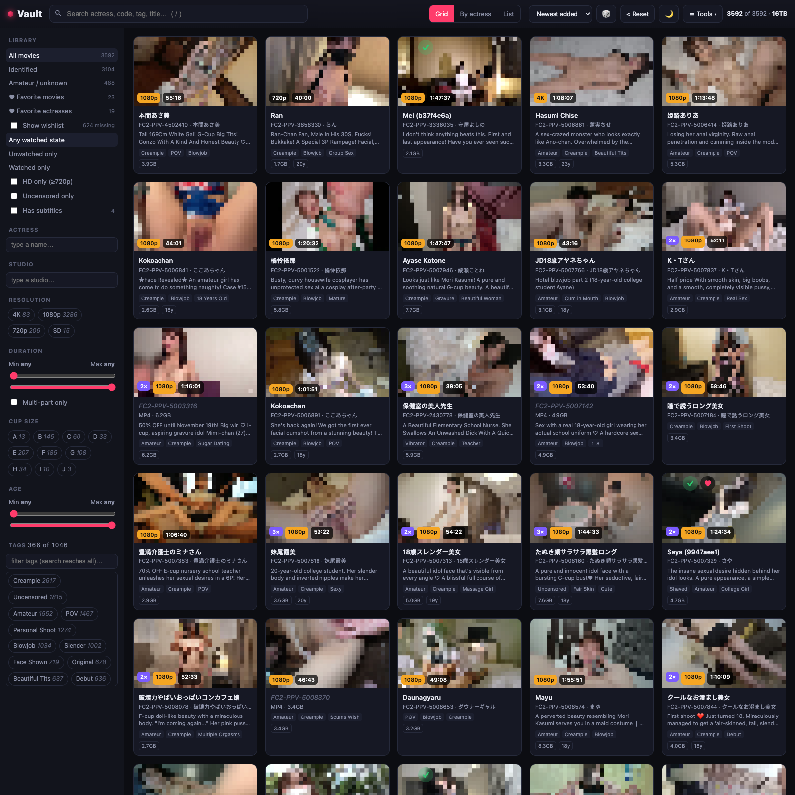
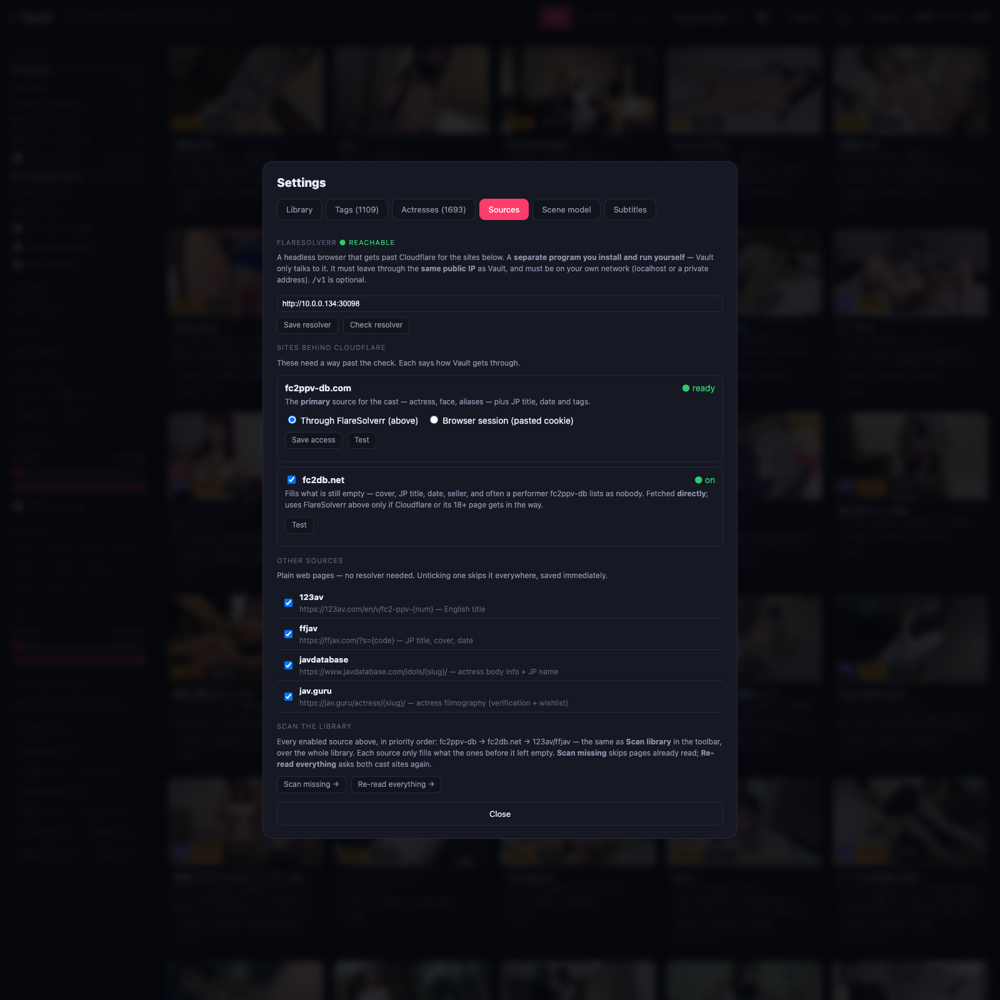

# Vault

**A self‑hosted, filterable “Plex for FC2 / JAV.”** Point it at a folder of movies and it becomes a fast, private web app: a poster wall with streaming playback, deep metadata filters, an actress catalog with faces and body stats, a wishlist of titles you don’t own yet, and one‑click tools to tidy, tag, and enrich your library from the web.

Runs entirely on your machine. No cloud, no accounts, no telemetry — a single Python file serves a single HTML page. The UI is fully responsive, so the same page works on a phone over your LAN or VPN.

**Download:** [Mac — Apple Silicon](https://github.com/fc2vault/vault/releases/latest/download/Vault-mac-apple-silicon.dmg) · [Mac — Intel](https://github.com/fc2vault/vault/releases/latest/download/Vault-mac-intel.dmg) · [Windows](https://github.com/fc2vault/vault/releases/latest/download/Vault-windows-setup.exe) — everything included (its own Python and ffmpeg), nothing else to install. Linux: [from source](#install).

> **Read [Privacy & safety](#privacy--safety) before exposing it.** Vault listens on **all interfaces** and has **no login**. **Settings → HTTPS → Turn on HTTPS** encrypts the traffic ([HTTPS](#https)), but it is not a login. On a trusted home network that is the point; it is not safe to port‑forward to the internet.



---

## Contents

- [Features](#features)
- [Free, and the scene model](#free-and-the-scene-model)
- [Requirements](#requirements)
  - [Optional: FlareSolverr](#optional-flaresolverr)
- [Install](#install)
- [Configure](#configure)
- [Run](#run)
- [A quick tour](#a-quick-tour)
- [User guide](#user-guide)
- [How metadata works](#how-metadata-works)
- [Subtitles (Whisper)](#subtitles-whisper)
- [Project layout](#project-layout)
- [Privacy & safety](#privacy--safety)
- [Troubleshooting](#troubleshooting)

---

## Features

**Browse & find**
- Grid, **By‑actress**, and **List** views over your whole library
- Sidebar filters: identified / amateur, **favorite movies**, **favorite actresses**, **wishlist**, watched state, HD, uncensored, actress, studio, resolution, duration, cup size, age
- Full‑text search across actress (incl. **aliases** and Japanese names), code, title, and tags — matches surface to the top
- Sort by **date added** (true first‑seen, not the copied file date), release, size, duration, rating, favorites, actress, code, or shuffle

**Use it anywhere**
- One responsive page — no separate mobile site and no UA sniffing; the layout keys off window width and pointer type, so a narrow desktop window behaves like a phone
- Phone layout: two‑column poster wall, filters in a slide‑over **☰ Filters** drawer, and a player that stacks the video above **Info** / **Parts · Related** tabs
- Reachable from any device on your LAN or over a VPN back to it (**no authentication** — see [Privacy & safety](#privacy--safety))
- The grid renders in batches as you scroll, so a multi‑thousand‑item library stays inside mobile Safari's memory budget

**Watch**
- In‑browser streaming with HTTP range requests + `sendfile` (fast seeks over SMB)
- Multi‑part playback with auto‑advance
- Keyboard shortcuts (space/s play, a/d and ←→ seek, y/c scene markers, v subtitles, ↑↓ volume, m, f, t theater, 0–9, `< >` speed)
- HEVC handled natively where the browser supports it, with a clear fallback panel where it doesn’t

**Curate**
- Rich edit panel: actress (EN + JP, with autocomplete), age, cup, height, measurements, censorship toggle, EN/JP titles
- **Reassign** a single misgrouped movie to another actress straight from the player (**⇄**) — relinks just that title, never renames the actress it left
- **Multi‑select** (shift / ⌘‑click, or the card's select box) → bulk‑assign one actress to many movies, or bulk‑delete them
- **Delete** a movie (from the player), several at once (multi‑select), or a whole actress and her movies (from her overview) — always confirmed; files are **moved to a recoverable trash**, never hard‑deleted. Deleting an actress trashes only titles where she is the sole performer; shared co‑star titles are kept
- **Scene markers**: the player draws scenes (e.g. *blowjob*, *doggy*, *cumshot*) as icon chips and ticks **right on the seek bar**, tube‑site style — hover for the label, click to jump. Vault places them itself with the free scene model (Settings → Scene model → **Place markers**, a 🎬 button per movie, or the nightly run) and keeps them next to the video as `<video>.scenes.json`. See **Scene markers** below
- **Organize** the folder on disk: normalize `…/<CODE>/<CODE>.ext`, quarantine junk, flag/relocate duplicates — preview first, nothing deleted
- **Organize by actress**: fold every movie into `…/<Actress>/<CODE>/` to match the catalog (so the disk follows reassignments) — preview first, only moves, never deletes
- **Nightly run** (Settings → Nightly): inside a time window you choose, Vault imports new downloads (with the Import window's choices made up front), looks up metadata for **new** movies only (a miss is retried after a week, not every night), places scene markers and writes subtitles — each step stops when the window ends and carries on the next night
- **Settings** hub: library and download folders, tags (rename/merge + **JP→EN translation**), actresses (rename, merge, **find duplicates**), sources, the scene model, subtitles, the nightly run and **HTTPS**

**Enrich**
- **Scan metadata** from the web (English/Japanese titles, covers, dates, tags) across your library
- **Enrich from web** per actress: body info, JP name, aliases — **verified by FC2‑code overlap** so you don’t attach the wrong same‑name person, and it fills her **wishlist** from her filmography

## Free, and the scene model

Vault is **freeware**: the whole app, every source, the catalog and the scene model, with no
movie limit, no key and no account. The terms are in [LICENSE.md](LICENSE.md).

**The scene model** is the trained video classifier that recognises scenes (blowjob, doggy,
cowgirl, missionary, creampie …) so Vault can mark them on the seek bar. It is a ~450 MB download
from the project's GitHub releases: open **Settings → Scene model** and press **Download**; every
improved build shows up in the same tab as an **Update**. Placing the markers is built into Vault
— see [Placing markers](#placing-markers).

**Support:** Vault is developed in the open and stays free. If it earns a place in your setup, a
contribution on [Patreon](https://www.patreon.com/FC2vault) helps cover the tools and the hours
that go into the next release. Nothing is required, and nothing is held back. Thank you.

## Requirements

The **Mac and Windows downloads** need nothing but a browser: they bring their own Python and ffmpeg
(see [Install](#install)). Running **from source** (Linux, or any OS) needs:

- **Python 3.8+** (standard library only — no `pip install`)
- **ffmpeg / ffprobe** on your `PATH` (posters + duration/resolution/codec)
- A modern browser (Chrome, Brave, Safari, Firefox)
- macOS, Linux or Windows (on Windows from source: `py serve.py`; the optional fc2ppv‑db session store uses the macOS Keychain, with a file fallback elsewhere)

Install ffmpeg:

```bash
brew install ffmpeg          # macOS
sudo apt install ffmpeg      # Debian/Ubuntu
```

### Optional: FlareSolverr

Vault works fully without it. It matters for exactly one source — **fc2ppv‑db**, which supplies
the **cast** (and JP titles, dates, covers, tags). That site sits behind a Cloudflare human
check, so Vault needs one of two ways through it:

1. **Paste a browser session** — no extra software. Log in, copy the `cookie:` and
   `user-agent:` headers from DevTools into Settings → Sources. It works, but the cookie is
   bound to that browser's IP and expires, so you re‑paste it every so often.
2. **Run FlareSolverr** — a small service that keeps a headless Chromium and clears the check
   for you. Nothing to re‑paste.

**FlareSolverr is a separate, third‑party program. Vault does not bundle, install or update
it**, and nothing here is affiliated with the project. Install it yourself only if you want
option 2 — see [FlareSolverr on GitHub](https://github.com/FlareSolverr/FlareSolverr) for
current instructions. It is commonly run as a container:

```bash
docker run -d --name flaresolverr -p 8191:8191 --restart unless-stopped \
  ghcr.io/flaresolverr/flaresolverr:latest
```

Then put its URL in **Settings → Sources → FlareSolverr** (`http://host:8191`; `/v1` is
optional) and press **Test connection**.

Two constraints worth knowing before you set it up:

- It must leave through the **same public IP** as Vault, or the clearance it obtains will not
  validate for Vault's requests. Running it on the same machine or the same LAN is the simple
  case; a VPN on one side and not the other is the usual reason a working resolver still fails.
- Vault only accepts a resolver on **loopback or a private address** (`127.0.0.1`, `10.x`,
  `192.168.x`, `172.16–31.x`). The server has no authentication, so it will not ship your page
  requests to an address on the public internet.

If no resolver is configured and no session is saved, every other source still works and scans
simply skip the fc2ppv‑db pass, saying so rather than failing.

## Install

**Mac:** download [Vault for Apple Silicon](https://github.com/fc2vault/vault/releases/latest/download/Vault-mac-apple-silicon.dmg) (M1 and later) or
[for Intel](https://github.com/fc2vault/vault/releases/latest/download/Vault-mac-intel.dmg), open it and drag **Vault** into **Applications**. The installers
are not signed with a paid Apple certificate, so the first time macOS refuses to open it: click
**Done**, then **System Settings → Privacy & Security → Open Anyway** (once). Vault asks for your movie
folder and opens in the browser; it runs while the app is open (Dock icon → the page again, Quit → stop).
Data lives in `~/Library/Application Support/Vault`.

**Windows:** download [the setup](https://github.com/fc2vault/vault/releases/latest/download/Vault-windows-setup.exe) and run it. If Windows says
*"Windows protected your PC"*, click **More info → Run anyway** (once; the installer isn't signed).
It installs for your user only, no administrator rights, with Start‑menu entries **Vault**,
**Vault - Stop** and **Vault - Choose movie folder**, and optionally starts Vault at log on. Data
lives in `%LOCALAPPDATA%\Vault`.

**Updating:** Vault looks for a new version once a day (Settings → Updates; you can switch that
off). **Update** downloads it, checks it against GitHub's checksum and installs it — on Windows the
setup runs silently and Vault restarts, on a Mac Vault swaps the app and reopens — your library,
settings and data stay as they are. Running the new setup or dragging in the new Vault.app by hand
works too. A newer catalog that comes with an update is merged into yours: new titles and
actresses are added and empty fields filled, but nothing you set, own or deleted is touched.

**From source** (Linux, or any OS):

```bash
git clone https://github.com/fc2vault/vault.git vault
cd vault
```

There’s nothing to build or compile. The rest of this README (Configure, Run, services) is about
running from source; the installers do those steps for you.

## Configure

*From source* — the installers ask for the movie folder on first start instead.

On first run Vault copies `config.example.json` to `config.json`. Edit it to point at your movies:

```json
{
  "library": "/path/to/your/movies",
  "port": 8730
}
```

You can also set the library from the CLI or in **Settings → Library** later:

```bash
python3 serve.py --library "/path/to/your/movies"
```

## Run

*From source* — with the installers, opening Vault does this.

```bash
python3 serve.py
```

Then open **http://127.0.0.1:8730/**. First launch walks the library (slower over a network share); after that it boots instantly from a cached index and refreshes in the background.

To run detached:

```bash
python3 serve.py > vault.log 2>&1 &
```

### Run at login (as a service)

*From source.* With the installers: on a Mac add Vault under System Settings → General → Login
Items; on Windows tick *Start Vault when I log on* in the setup.

```bash
python3 serve.py --install-service      # starts at login, restarts if it stops
python3 serve.py --service-status
python3 serve.py --uninstall-service
```

This registers a per‑user service with no administrator rights: a **launchd** agent on macOS
(`~/Library/LaunchAgents/local.vault.server.plist`), a **systemd --user** unit on Linux
(`~/.config/systemd/user/vault.service`; run `loginctl enable-linger` on a headless box so it
runs without a login session), and a **Task Scheduler** task named *Vault* on Windows that runs
at log on with `pythonw.exe`, so no console window. The service runs the same `serve.py` with the
same Python that ran the install, and logs to `server.log` next to the config.

macOS note: background jobs get no access to **Documents, Desktop, Downloads or removable
volumes** (the system cannot show the permission prompt). Keep the Vault folder somewhere else,
for example `~/vault`, or grant `python3` Full Disk Access in System Settings → Privacy &
Security. `--install-service` checks the log after starting and tells you if this happened.

### On your phone or another computer

Vault listens on every interface, so from any device on the same network (or connected to your LAN over VPN) open:

```
http://<this-machine-ip>:8730/
```

Find the address with `ipconfig getifaddr en0` (macOS) or `hostname -I` (Linux). The layout adapts on its own — no separate mobile site, no app to install:

- **Phone:** two‑column poster wall; filters live behind a **☰ Filters** drawer; the player stacks the video on top with **Info** and **Parts / Related** tabs beneath it.
- **Tablet / small window:** the same rules key off window width, so a narrow desktop window gets the compact layout too.

The grid renders in batches as you scroll, which is what keeps a multi‑thousand‑item library from exhausting mobile Safari's per‑tab memory.

Nothing here is authenticated — see [Privacy & safety](#privacy--safety).

---

## A quick tour

**Grid** is the home view — a poster wall with actress, code, tags, and size/age/cup pills. Click a card to play; **shift/⌘‑click** to select several.

**Detail / player** shows the movie with the actress up top (English → Japanese → code), her stats as pills, full technical metadata, tags, rating, and a filmography rail of her other titles (owned + wishlist).


**Settings** is where you manage everything — library and download folders, tags, actresses, sources, the scene model and markers, subtitles, the nightly run and HTTPS.



See the **[full user guide](docs/USER_GUIDE.md)** for a screenshot walkthrough of every feature.

## User guide

The detailed, screenshot‑driven guide lives in **[`docs/USER_GUIDE.md`](docs/USER_GUIDE.md)** and covers:

- Browsing, filtering, sorting, and the wishlist
- Playback and keyboard shortcuts
- Editing a movie’s actress & metadata
- Reassigning a misgrouped movie to another actress
- Multi‑select bulk actress assignment
- Organizing the library folder (by `<CODE>` and **by actress**)
- Scanning & enriching from the web (and the verification model)
- Importing from your download folder
- English subtitles, scene markers and the nightly run
- Settings: library, **tags + translations**, **actresses + dedup**, sources, scene model, subtitles, nightly, HTTPS
- Connecting the optional **fc2ppv‑db** source

## How metadata works

Vault treats your **filesystem as the spine** and the catalog database (`data/catalog.db`) as an enrichment overlay. Each source fills what it's best at, and Vault never overwrites a value you set by hand. **[`SOURCES.md`](SOURCES.md)** has the details.

Highlights:
- **Local first** — duration/resolution/codec from `ffprobe`, posters from `ffmpeg`.
- **Scan metadata**, in priority order: **fc2ppv‑db** (the cast, JP title, date, cover, tags — optional, it sits behind a human check: paste a browser session in Settings → Sources, or point Vault at a FlareSolverr on the same public IP), then **fc2db.net**, then **123av** (English titles) and **ffjav** — each only filling what the ones before left empty.
- **Verified actress enrichment** — javdatabase + jav.guru, gated by FC2‑code overlap with your library.
- **Canonical tags** — every scraped tag is routed through the JP→EN / merge table before it’s stored: Japanese tags become their English label, merged tags stay merged (a merge you make is remembered for future scans), and untranslated Japanese one‑offs are dropped instead of polluting the set. English tags without a mapping are kept as‑is.

## Scene markers (sidecars)

The player draws scene markers **on the seek bar** from **`<video>.scenes.json`** sidecar files
next to each video. Vault writes them with its built-in scene tagger ([Placing markers](#placing-markers)),
and any other tool that follows the format can too; Vault reads them and caches them in a
`markers` table. Markers are shown as start points, view-only.

Format (`schema: "vault-scenes/1"`), timestamps in seconds, relative to that one video file:

```json
{
  "schema": "vault-scenes/1",
  "video": "FC2-PPV-1234567.mp4",
  "duration": 1800.0,
  "generator": "vault-scene-tagger 0.1.0",
  "generated_at": "2026-11-20T16:50:19Z",
  "markers": [
    { "t": 120.0, "end": 300.0, "label": "blowjob", "confidence": 0.82, "source": "ml" },
    { "t": 900.0, "label": "cumshot", "source": "manual" }
  ]
}
```

Merge rule: the tagger owns `source` values `cut` / `heuristic` / `ml` and may rewrite them on
every run; markers with `source: "manual"` are always preserved. Drop a sidecar next to any movie
and open it — the markers appear. (Vault generates its own scrub‑bar thumbnails; a sidecar sprite
sheet is not required.) The full, versioned format is **[`SCENES_SPEC.md`](SCENES_SPEC.md)**.


### Placing markers

Vault places the markers itself with the scene model. Once, in **Settings → Scene model**:

1. **Download** the scene model (~450 MB).
2. **Set up** — installs what the model needs to run (PyTorch, about 1 GB) into Vault's own
   environment, the same one the subtitles use. On an Apple Silicon Mac it runs on the GPU; on
   Windows or Linux with an NVIDIA card Set up picks the CUDA build. Anywhere else it runs on the
   processor, which works but takes hours per movie.

Then:

- **Place markers on N movies without them** (same tab) works through the library in the
  background, with progress and **Stop**;
- **🎬 Place markers** in a movie's panel does one movie;
- the **nightly run** (Settings → Nightly → Scene markers) does new movies, or the whole library,
  inside its time window.

It takes a few minutes per movie (about 3× realtime on an M1 Mac; an NVIDIA GPU is faster).
Movies that already have markers are skipped, and stopping is safe. A movie's markers appear the
next time you open it.

The tagger also runs on its own, for scripting: `python scene_tagger.py "/path/to/library"
--engine phar` with a Python that has `torch`, `transformers` and `numpy` (the one Set up made is
`<Vault data>/whisper-env`). `--help` lists the options; `--phase a` writes shot cuts only.

## Subtitles (Whisper)

**Tools → 💬 Transcribe** (or **💬 Transcribe (JA → EN)** in a movie's panel) writes English
subtitles from the Japanese audio — offline, on your computer. Each part gets `<video name>.en.srt`
(and the Japanese `<video name>.ja.srt`) next to the file, the names Plex, VLC, Infuse and mpv pick
up on their own. Vault's player shows them with the **CC** button (or **v**); **Shift+Y / Shift+C**
jump to the previous / next line, and the sidebar's **Has subtitles** filter finds the movies that
have them. Jobs run one part at a time in the background; the Tools menu shows the progress.

**How it works.**
1. **Find the talking.** A speech detector (Silero VAD) marks where people speak, on the voice band
   evened out in level so quiet talk under moaning counts too. It restarts every 30 s — over long
   stretches of moaning it otherwise stops hearing speech at all.
2. **Listen (Whisper).** Whisper hears only those stretches, glued together, and writes Japanese;
   the times are mapped back onto the movie, so lines appear when they are spoken. Pauses of 6 s
   or more where the detector wasn't sure get a second, careful listen in 6 s pieces (words said
   while moaning, which the detector misses), keeping only lines Whisper is confident about.
3. **Translate.** Whisper is unloaded and a small local LLM translates the Japanese 15 lines at a
   time, with the conversation around them and a glossary of the usual vocabulary, so explicit
   lines stay explicit. Apple Silicon: mlx-lm with `mlx-community/Qwen3-4B-Instruct-2507-4bit`
   (2.3 GB). Windows / Linux: run Ollama or LM Studio and enter its address and model in
   Settings → Subtitles. *Whisper only* (Settings) skips the LLM: faster, rougher English.
4. **Clean up.** Invented lines ("thank you for watching", loops), lines that are only moans,
   sighs or laughter, and anything not confidently speech are dropped; short answers (はい, いや,
   うん) and questions stay.

Expect roughly 15–30 minutes per hour of video on an 8 GB M1 Mac (the second listen costs the most on
movies with long sex scenes). Memory stays capped — Whisper at a third of the RAM, the translator
at 40 % — so the computer stays usable.

Whisper runs in its own Python environment, apart from Vault's. **Settings → Subtitles → Set up**
creates `<Vault data>/whisper-env` and installs what runs fastest on that machine (about 1 GB; the
models download on first use). The installers build it from their own Python; from source it needs
Python 3.10+ on the computer:

| Engine | Where | Notes |
|---|---|---|
| `mlx-whisper` | Apple Silicon | Metal GPU — the default on an M-series Mac (plus `mlx-lm` for the translator) |
| `faster-whisper` | Windows / Linux / Intel Mac | CPU (int8), or an NVIDIA GPU via CUDA |
| `openai-whisper` | anywhere PyTorch runs | the reference build |

Or install one yourself and put that Python in the same Settings tab. `auto` uses the first of
mlx → faster → openai that imports. Model: **large-v3** (best, ~1.6 GB as the 8-bit build on a Mac,
downloads on first use), medium or small. It decodes the audio with ffmpeg (bundled in the
installers; from source it must be on the PATH).

The worker, `tools/transcribe.py`, also runs on its own:
`python tools/transcribe.py movie.mp4 movie.en.srt --translator llm --ja-out movie.ja.srt`.
Switches for special cases: `--keep-moans`, `--no-quiet-pass` (skip the second listen: much
faster, misses words under moaning), `--relisten pieces` (one Whisper call per 6 s piece: slower,
keeps every repeat of a short word), `--no-voice-filter` (raw audio).

## Project layout

```
serve.py             # the app + HTTP API (Python stdlib)
index.html           # the entire front‑end (vanilla JS, no build step)
scan.py              # web sources + enrichment (fc2ppv‑db, fc2db.net, 123av, ffjav, javdatabase, jav.guru)
catalog.py           # the catalog database
organize.py          # preview‑then‑apply library tidy (never deletes/overwrites)
rename_fc2.py, refolder_fc2.py, migrate_fc2.py   # Import: rename, clean, move into the library
dedupe.py            # find & merge duplicate actress records
subtitles.py         # Whisper transcription queue (Tools → Transcribe)
tools/transcribe.py  # the Whisper worker (runs with the Whisper Python)
vault_model.py       # the scene model download (Settings → Scene model)
scenetag.py          # placing markers (Settings → Scene model → Place markers)
scene_tagger.py, vault_scene_tagger/   # the scene tagger itself
final_tags.py        # which markers become tags
nightly.py           # the nightly run (Settings → Nightly)
tlsgen.py            # HTTPS certificates (Settings → HTTPS)
vault_service.py     # --install-service (launchd / systemd / Task Scheduler)
packaging/           # how the Mac and Windows installers are built
data/catalog.db      # preloaded catalog (SQLite): actresses, works, tags, aliases, links
config.json          # your library path + port (gitignored)
docs/                # the user guide + screenshots
```

The Mac disk images and the Windows setup are built by GitHub Actions from `packaging/` when a
release is published, and attached to it.


## Privacy & safety

- **No cloud, no telemetry.** Vault has no accounts and phones home to nothing. It goes online only for: the metadata scans you start (and the nightly run's scan of new movies, if you switch it on), **Enrich from web**, a look at GitHub for a newer Vault once a day (Settings → Updates can switch it off) and for the newest scene model when you open Settings → Scene model, and the downloads you ask for (the scene model; the packages and models that Set up and the first transcription fetch). Your movies, audio, subtitles and markers never leave the computer.
- **It is not access‑controlled.** The server binds `0.0.0.0`, so anyone who can reach the port gets the whole library — there is **no login** (HTTPS, when you turn it on, encrypts the traffic but locks nobody out). Two endpoints act on the host machine rather than just returning data:
  - `POST /api/open` — opens a file in your desktop video player
  - `POST /api/reveal` — reveals it in Finder

  Treat reachability as the only control. Keep it on a network you trust (LAN or a VPN back to your LAN); do **not** port‑forward it or put it on a public/coworking Wi‑Fi. Running from source, you can pin it to this machine only by changing the bind in `serve.py`:

  ```python
  srv = SERVER = VaultServer(("127.0.0.1", port), Handler)   # was "0.0.0.0"
  ```
- <a id="https"></a>**HTTPS is one button.** **Settings → HTTPS → Turn on HTTPS** makes a small private certificate authority and a certificate for this computer (its names and network addresses, valid 825 days) and switches HTTPS on at once, on the normal port — no restart, no openssl. Plain HTTP keeps working on the machine itself; other devices are redirected to `https://`. Each phone or computer trusts the certificate once: the tab shows the steps, starting at `http://<this-machine>:8730/vault-ca.crt`. **Renew** makes a new certificate (e.g. after the computer got a new address) from the same authority, so devices keep trusting it; **Turn off** parks the certificate, and turning on again reuses it. To use your own certificate instead, put `vault.crt` and `vault.key` (and optionally `vault-ca.crt`) in Vault's `tls` folder and restart. The folder is `~/Library/Application Support/Vault/tls` on macOS, `%LOCALAPPDATA%\Vault\tls` on Windows and `~/.local/share/vault/tls` on Linux; any certificate that names this machine works. `--no-tls` keeps HTTPS off.
- **Non‑destructive by design.** Organize *moves* junk/duplicates into recoverable folders and never deletes or overwrites; enrichment is fill‑if‑empty and never clobbers your edits.
- **Secrets** (the optional fc2ppv‑db session) are stored in the **macOS Keychain** (encrypted), or a `0600` file elsewhere — never in the repo.
- Web scraping honors each site’s access model; the one human‑checked source is only ever reached through a session **you** authenticate.

## Troubleshooting

| Symptom | Fix |
|---|---|
| “no valid library folder” on start | Installers: Vault asks for the folder (Windows: Start menu → **Vault - Choose movie folder**). From source: set `library` in `config.json`, or `--library "…"`, or **Settings → Library**. |
| No posters / durations | The installers bring ffmpeg. From source: install `ffmpeg`/`ffprobe` and make sure they’re on `PATH`. |
| Vault doesn't start (installers) | The log is `~/Library/Application Support/Vault/server.log` (Mac — or the app menu → **Show Server Log**) or `%LOCALAPPDATA%\Vault\server.log` (Windows). |
| Slow first boot | Normal over SMB — it caches after the first walk and boots instantly next time. |
| A movie didn’t appear after copying it in | **Scan library** re‑indexes the filesystem first; new folders show up then. |
| A movie you own still shows Status **missing** | Its catalog row is stale. Any scan/rescan reconciles it — the log prints `[db] N work(s) marked available`. The import pipeline now marks them as it goes. |
| Can’t reach it from your phone | Use the machine’s LAN IP, not `127.0.0.1`; check both devices are on the same network (or the VPN is up) and that a firewall isn’t blocking the port. |
| Phone tab reloads or dies on a huge library | Should not happen — the grid renders in batches. If it does, narrow the view with a filter and file it as a bug. |
| Newly added folder not on top of “Newest added” | Vault sorts by **first‑seen**; a freshly‑dropped `<CODE> - Name` folder is treated as new. |
| Wrong port after launch | `serve.py` remembers the last `--port` in `config.json`; edit it back or pass `--port 8730`. |
| fc2ppv‑db **Test connection** fails with a fresh cookie | Vault tries the request over both IPv4 and IPv6 (a `cf_clearance` cookie is bound to the exact address that solved Cloudflare's check, and dual‑stack machines don't always use the same one). If it still fails, the cookie has expired — re‑copy it — or your browser is on a different public IP than the server (e.g. a VPN). |
| fc2ppv‑db **Test connection** fails in FlareSolverr mode | The resolver must be running, and Vault must be able to reach its URL. It has to egress through the same public IP as Vault. A URL without `http://` is accepted; `/v1` is added if you leave it off. FlareSolverr is a [separate program you install yourself](#optional-flaresolverr) — Vault neither bundles nor starts it. |
| A scan says **“fc2ppv‑db pass skipped”** | No resolver and no saved session, or the resolver didn't answer. The titles pass still ran; set up [one of the two routes](#optional-flaresolverr) and scan again. Everything else works without it. |
| A movie stays unidentified after a scan | Open it: the panel says **“fc2ppv‑db · no performer listed”** (the site genuinely has nobody — scanning again won't help) or **“not checked yet”** (it will). |

---

## A note on this build

This is the **public build**. Its screenshots are sanitized — poster art in the library views
is pixelated, and the settings/scan/import dialogs are cropped to the dialog itself — and the
bundled catalog carries no actress portraits, only text metadata (names, aliases, measurements,
titles, tags, dates, cover URLs). Vault itself is unchanged: **Enrich from web** fetches
portraits into your own local catalog, and posters are generated from your own files, so your
install looks like the real thing.
