# Vault — User Guide

A feature‑by‑feature walkthrough. To install, download Vault for Mac or Windows from the [latest release](https://github.com/fc2vault/vault/releases/latest) (see the README's **[Install](../README.md#install)**); running from source and setup details are in the main **[README](../README.md)**.

## Contents

1. [The main window](#1-the-main-window)
2. [Filtering & sorting](#2-filtering--sorting)
3. [The wishlist](#3-the-wishlist)
4. [Playing a movie](#4-playing-a-movie)
5. [Editing a movie](#5-editing-a-movie)
6. [Multi-select: bulk-assign an actress](#6-multi-select-bulk-assign-an-actress)
7. [Import from your download folder](#7-import-from-your-download-folder)
8. [Scan metadata from the web](#8-scan-metadata-from-the-web)
9. [Enrich an actress (verified)](#9-enrich-an-actress-verified)
10. [Settings](#10-settings)
    - [Scene model & placing markers](#scene-model)
    - [Library & cache](#library--cache)
    - [Tags & translations](#tags--translations)
    - [Actresses & de-duplication](#actresses--de-duplication)
    - [Sources & fc2ppv-db](#sources--fc2ppv-db)
    - [Subtitles](#subtitles)
    - [HTTPS](#https)
    - [Updates](#updates)
    - [Nightly](#nightly)
11. [Using Vault on your phone](#11-using-vault-on-your-phone)
12. [Subtitles (Japanese → English)](#12-subtitles-japanese--english)
13. [The nightly run](#13-the-nightly-run)

---

## 1. The main window

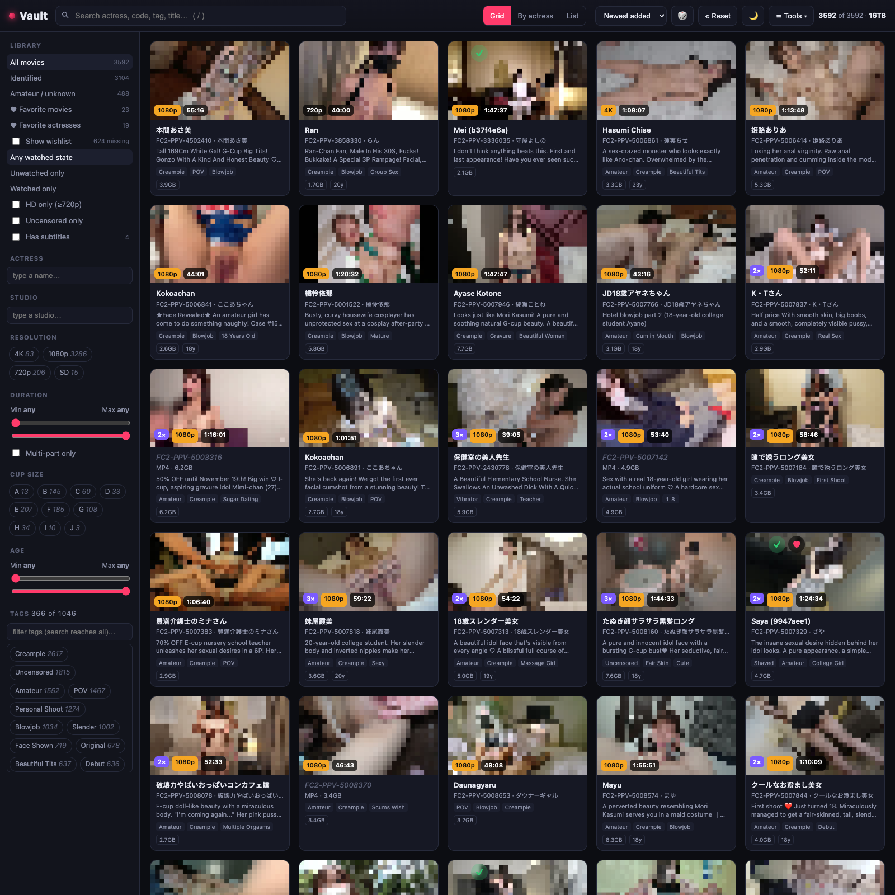

- **Top bar:** search, the **Grid / By actress / List** view switcher, a sort dropdown, a shuffle die, **Reset** filters, and the **☰ Tools** menu with **📥 Import**, **Scan library**, **💬 Transcribe** and **Settings**. The Tools button's gear turns while any of them runs in the background; open the menu to see the progress. The right side shows how many titles match and the total library size.

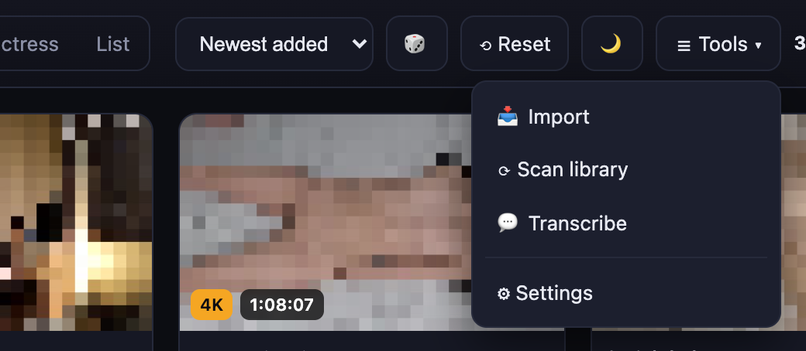
- **Left sidebar:** all your filters (see below).
- **Main area:** poster cards. Each shows the actress (or code if unidentified), the FC2 code + Japanese name, tags, and pills for size · age · cup. Along the **bottom** of each thumbnail, badges mark multi‑part (`2×`), resolution, duration, and a red **CENSORED** flag (in that order).
- Hover a card for its **top‑left** controls, left→right: a **select** box (for multi‑select), the **✓ played** toggle, and the **♥ favorite** toggle.

Switch to **By actress** to group the wall under each performer (with her portrait and stats), or **List** for a dense, sortable table.

## 2. Filtering & sorting

Everything in the left sidebar narrows the view live:

- **Library:** all / identified / amateur‑unknown / **favorite movies** / **favorite actresses**
- **Show wishlist**, **watched state, HD only, uncensored only, has subtitles**
- **Actress** and **Studio** type‑ahead boxes (actress matches aliases and Japanese names too)
- **Resolution, Duration** (with **Multi‑part only**), **Cup size, Age** ranges
- **Tags** — click any number of tag chips; the box above them narrows the list

The **sort dropdown** offers Newest added, Release date, Largest, Longest, Top rated, Most favorited, Actress A–Z, Code, and Shuffle (the 🎲 next to it reshuffles). “Newest added” uses a **true first‑seen** timestamp, so a folder you just dropped in sits at the top even if its file dates are old.

> Your **played state, favorites and ratings are saved on the server** (a `userdata.json` beside the database), so they persist across browsers and survive a cache wipe or a catalog rebuild. Existing per‑browser data is migrated up automatically the first time each browser connects.

**Search** (top bar or press `/`) matches actress, aliases, Japanese name, code, title, and tags — and when you search a name, her titles are floated to the top ahead of incidental keyword hits.

## 3. The wishlist

Tick **Show wishlist** in the sidebar to include titles you *don’t* own — “ghost” cards drawn from an actress’s known filmography. They’re only shown for performers you already own at least one title of, so the wishlist stays relevant. Ghosts show a cover (where known) and a `missing` badge; the rest of the app treats them as first‑class (they appear in her filmography rail, etc.).

In **By‑actress** view, click an actress’s portrait or name to open her **overview** — bio and measurements, everything you own, and everything missing. Each missing title has a **Search on sukebei** action that opens a search for its code in a background tab.

**Favorite an actress** with the **♥** — either on her group header in By‑actress view, or in her overview header (next to **✎**). The sidebar’s **♥ Favorite actresses** filter then narrows the wall to every title she leads *or* co‑stars in.

**Delete an actress** with the **🗑** in her overview header. After a confirmation that spells out exactly what will happen, it removes her profile and moves to the recoverable trash every movie where she is the **only** performer; titles she merely **co‑stars** in are **kept** — she is just removed from their cast and a co‑star is promoted to lead.


## 4. Playing a movie

Click any owned card to open the detail/player view.


- **Left rail:** her **Filmography** — every title (owned + `◇` wishlist), with the current one highlighted.
- **Center:** the video (range‑streamed for fast seeking; multi‑part titles auto‑advance).
- **Right panel:** actress name in a fixed order — **English → Japanese → code** — then, for a multi‑actress title, a **co‑stars** row (each clickable to open that performer's overview), her stats as pills (age · cup · height · B·W·H), technical **metadata**, favorite / played / **censored toggle**, external‑player & Finder buttons, **Scan metadata**, your star rating, editable **tags**, and a **🗑 Delete movie** button. A movie's cast is a **many‑to‑many** relationship — one lead (**main**) plus any number of **co‑stars** — so a title shows up under every performer in it.
  - **Click her name** (the **›** caret) to fold out her full **overview** — portrait, bio, and everything owned + missing — without leaving the movie.
  - **⇄** (next to the ✎ edit button) **reassigns just this movie** to another actress — see [§5](#5-editing-a-movie).
  - **Scenes on the seek bar:** the player uses a custom control bar with the scenes drawn on the scrubber — **clickable pictogram chips** above the bar (click to jump), **⏮ / ⏭** (or `←` / `→`) to step to the previous/next scene, colored **ticks** on the bar at each scene's start, a hover **label + time** tooltip, and a **"▶ now"** badge for the current scene. Vault places them with the scene model — **🎬 Place markers** in the right panel, Settings → Scene model, or the nightly run — and keeps them in a `<video>.scenes.json` sidecar next to the movie.
  - **Scrub previews:** hover over the seek bar and a frame from that moment shows above it, with
    the time and the scene. **Drag** the bar and the frame fills the video — the video itself only
    jumps when you let go, so scrubbing stays smooth even when the movie streams from a NAS. The
    first time you open a movie Vault makes its preview in the background: rough after a few
    seconds, sharper while you watch, complete after about a minute per hour of video. Until the
    first frames are in, dragging seeks the video directly. The nightly run can make them ahead of
    time.
  - **Placed by the model:** a marker the scene model placed wears an **amber dashed ring**, its tick on the bar gets an amber outline, and the label overlay shows a small **AI** badge. The chip's bottom edge keeps its label colour — pink for acts (blowjob, fingering, titjob, toy, creampie), violet for positions (missionary, doggy, cowgirl, standing, scoop‑up) — so you can read *what* it is at a glance. The player shows one marker per change of action, so the bar stays readable, and jumping to a **creampie** lands 15 s before it so you see it happen.
  - **Subtitles:** a movie with subtitles shows a **CC** button in the control bar (or press `v`); `y` / `c` jump to the previous / next line. The right panel's **💬 Transcribe (JA → EN)** makes them for this movie — see [§12](#12-subtitles-japanese--english).
  - **Volume:** hover the speaker icon and a slider unfolds next to it; the level and mute state are remembered across movies. Clicking the speaker mutes, clicking it again brings the previous level back.

**Keyboard:** `space` or `s` play‑pause · `q` / `e` seek ∓10s (`shift`: ∓5s) · `a` / `d` previous / next marker start *or end* (start, end, next start … — handy for tagging) · `y` / `c` previous / next subtitle line · `←`/`→` previous / next scene (`shift`: seek ∓60s) · `v` subtitles on/off · `↑`/`↓` volume · `m` mute · `f` fullscreen · `t` theater · `0–9` jump to % · `<`/`>` speed.


> `q` `e`, `a` `s` `d` and `y` `c` all sit under the left hand (on a QWERTZ keyboard), so the right one can stay on the mouse.

**Esc closes one thing at a time**, topmost first: fullscreen, then an actress sheet you opened from the movie, then the player itself. Opening a performer's overview from a movie and pressing `Esc` returns you **to the movie**, not to the grid.

**On a phone** the three columns can't sit side by side, so the player restacks: the video pins to the top with a **×** over it, and the two side panels become tabs underneath —

- **Info** — everything from the right panel above.
- **Parts N** / **Related N** — the left rail. It's named after what it holds: the part list for a multi‑part title, otherwise her filmography. Opening an entry reloads the player and returns you to **Info**.

## 5. Editing a movie

Click the **✎** in the detail panel to edit. You can set the movie’s English & Japanese title and the **actress** (English + Japanese), **age, cup, height, bust/waist/hip**. The actress field autocompletes against your catalog — and matches by Japanese name **or reversed word order**, so “Sora Mikumo” resolves to an existing “Mikumo Sora” instead of creating a duplicate. Picking a known actress instantly fills her stored numbers so you can see what will be applied.

> **Only the actress identity is written when you *switch* a movie to an existing performer** — her body numbers are pulled from her record, never overwritten with the form’s stale values. Edit her profile only when you’re editing that same actress.

The **censorship** state is a one‑click toggle (🔓 Uncensored / 🔒 Censored) right in the detail panel — no edit mode needed.

### Why a movie has no performer

When a title is unidentified the panel says which of the two reasons applies, so a blank name
is never a mystery:

- **`fc2ppv-db · no performer listed`** — the page *was* read (hover for the date) and the site
  genuinely has nobody for that code. Scanning again will not help; name her yourself if you
  can.
- **`fc2ppv-db · not checked yet`** (amber) — nobody has asked yet. **Scan metadata** will.

### Reassign vs. edit — moving one misgrouped movie

There are two different actions on the actress, and it matters which you use:

- **✎ Edit** operates on **the actress record**. Changing the name here on an already‑identified movie **renames that actress** (it affects *all* her titles) — use it to fix a spelling or edit her profile.
- **⇄ Reassign** (next to ✎) operates on **this one movie**. It relinks only the open title to another actress — the actress it *left* is never renamed and keeps her other movies. Use it when a title was grouped under the wrong person.

The reassign box autocompletes against your catalog and tells you live whether the name you type **links to an existing actress** or **will create a new one** (word‑order and Japanese‑name matches are still resolved on save, so “Sora Mikumo” finds “Mikumo Sora”). It regroups the catalog immediately; it does **not** move files on disk — see [Organize by actress](#7-import-from-your-download-folder) for that.

For moving *many* movies to one actress at once, use [multi‑select](#6-multi-select-bulk-assign-an-actress).

### Delete a movie

The **🗑 Delete movie** button at the bottom of the player removes the open title, after a
confirmation dialog. Its video file(s) are **moved to a recoverable trash** — the macOS **Trash**
for a library on your internal disk, or a **`_vault_trash/`** folder at the library root for a
library on a network/external volume (where macOS can't use the Trash). Either way it is instant
(a same‑volume move, no copying) and nothing is permanently erased; the library scan ignores that
folder so a deleted movie won't re‑appear. A wishlist entry (no file) is simply removed from the
catalog.

Vault releases the video before it moves anything — a network share will refuse to rename a
folder while a file inside it is open. If something *else* still holds the file you get
**"… is still open — close the player and try again"** rather than a long wait: a trash move is
either instant or an error, never a silent multi‑gigabyte copy.

## 6. Multi-select: bulk-assign an actress

In Grid or List view, tick the **select box** at a card’s top‑left, **⌘‑click** (or Ctrl‑click) to toggle individual cards, or **shift‑click** to select a range. Once anything is selected the select boxes stay visible on every card; selected cards get a pink outline and a filled box, and a bar appears at the bottom:

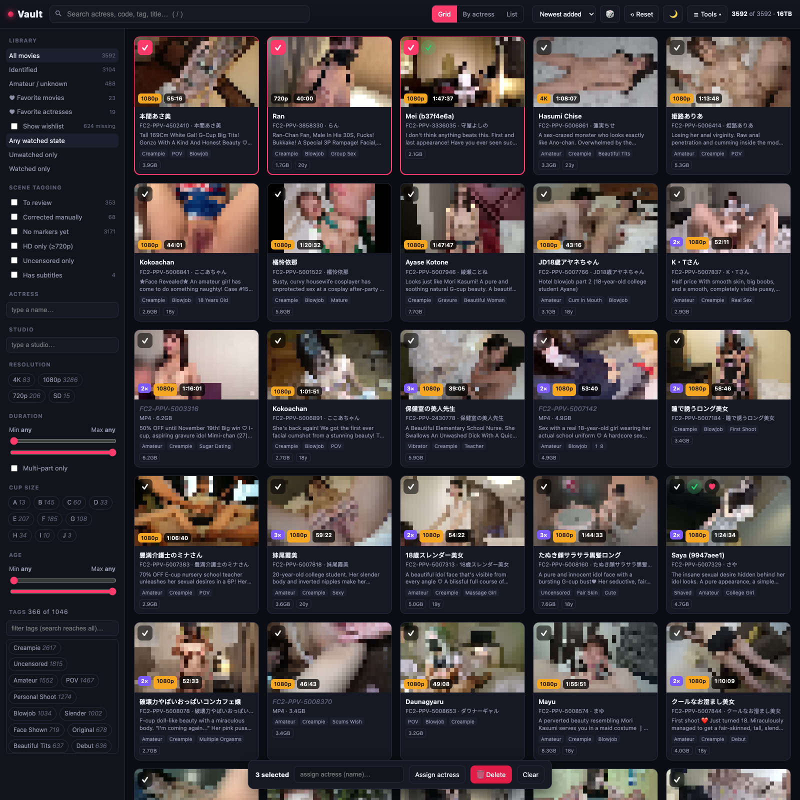

Type an actress name (autocompletes) and hit **Assign actress** to attach her to every selected movie at once. Bulk edit touches **only the actress** — never per‑movie fields — and uses the same smart matcher, so it won’t spawn duplicates. **🗑 Delete** in the same bar moves every selected movie to the recoverable trash (after a confirmation showing how many and how large).

## 7. Import from your download folder

Point Vault at a **download folder** (Settings → Library), then pick **📥 Import** in the **☰ Tools** menu. It previews the whole pipeline first, then: renames & cleans the downloads, and moves each release into the library — **adding** new ones and **replacing** older copies with better versions.

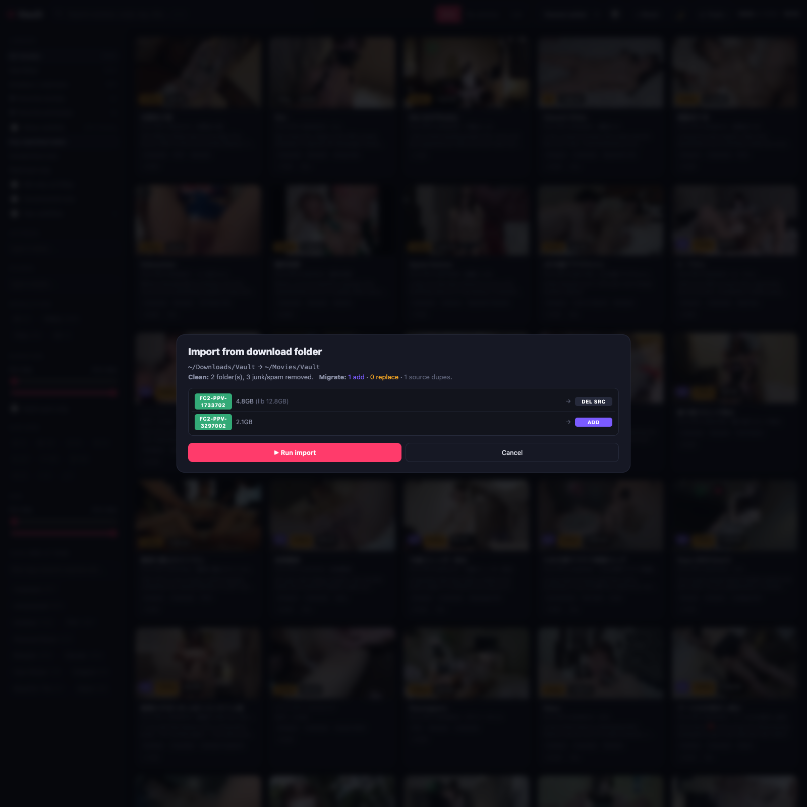

**What happens to a download:**

| Step | Example |
|---|---|
| The release is recognised by its code, whatever the uploader called it | `(無修正) FC2 PPV 1790483 …`, `fc2-ppv-1790483-HD` → `FC2-PPV-1790483` |
| | `[FC2-OMU] - 340671 - …` → `FC2-OMU-340671` |
| | `081726_01-10MU` → `10musume-081726_01` · `[Uncensored HD] N0852 …` → `N0852` · `ABC-123 - name` → `ABC-123` |
| Junk goes: text and HTML files, images, spam folders, and sample/spam clips under 80 MB | |
| The movie is renamed to its code; a release in parts becomes `-1`, `-2`, … | `FC2-PPV-1790483-1.mp4`, `FC2-PPV-1790483-2.mp4` |
| Loose files in the download folder are grouped into one folder per release | |
| It lands in the library as `…/<CODE>/<CODE>.mp4` | |
| A copy you already have: the **bigger** one wins, if you allow it | the smaller one is the duplicate |

A folder Vault can't find a code in is skipped and listed, not touched.

- Library deletes (replacing an older copy) are gated behind a **confirmation checkbox** — leave it unticked to only add + clean. Nothing in the library is removed without it.
- The move runs in the background (large cross‑drive copies can take a while). After *Run in background* the Tools button's gear turns; click **📥 Import** again to bring the progress back.
- When the import finishes, Vault **scans the new movies' metadata by itself** (the same passes as Scan library, only for the movies just added).
- The **nightly run** can do all of this for you every night, with the two choices made up front — see [The nightly run](#13-the-nightly-run).

**Organize** (Settings → Library → *Organize library…*) tidies files already in the library — junk to `_vault_trash/`, duplicates to `_Duplicates/` (largest kept), names normalized to `…/<CODE>/<CODE>.ext`. It previews first and never deletes or overwrites. Rarely needed now that Import handles new files.

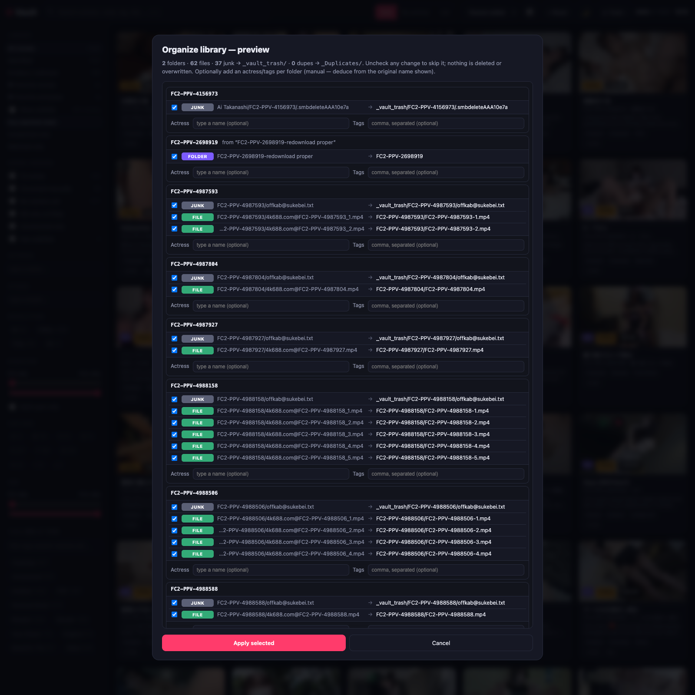

**Organize by actress** (Settings → Library → *Organize by actress…*) folds each movie so the **disk layout matches the catalog**: identified titles move to `…/<Actress>/<CODE>/`, unidentified ones move back to the root. It reads the catalog (not the folder names), so it also relocates anything you [reassigned](#5-editing-a-movie) in the app. It previews every move first with a per‑row skip, only ever moves whole `<CODE>` folders (never deletes a movie), skips `_Duplicates` / `_vault_trash` / `_unsorted` and any move whose destination already exists, and removes actress folders left empty afterwards.

> Vault groups everything by the **catalog**, not by folder, so a reassignment is correct in the app immediately — this step is only for keeping the files on disk tidy to match. A first run on a library that was never foldered this way can move a lot of folders; that's expected.

## 8. Scan metadata from the web

**Scan library** (☰ Tools) checks your sources in **priority order**, and each one only fills what the ones
before it left empty:

1. **fc2ppv‑db** — the primary source: cast, Japanese title, date, cover, tags.
2. **fc2db.net** — fills what fc2ppv‑db left, and often names a performer it lists as nobody.
3. **123av / ffjav** — the English title (only 123av has it), then anything still empty.

The first two each have a checkbox and a "not read yet" count that follows the rows you tick.

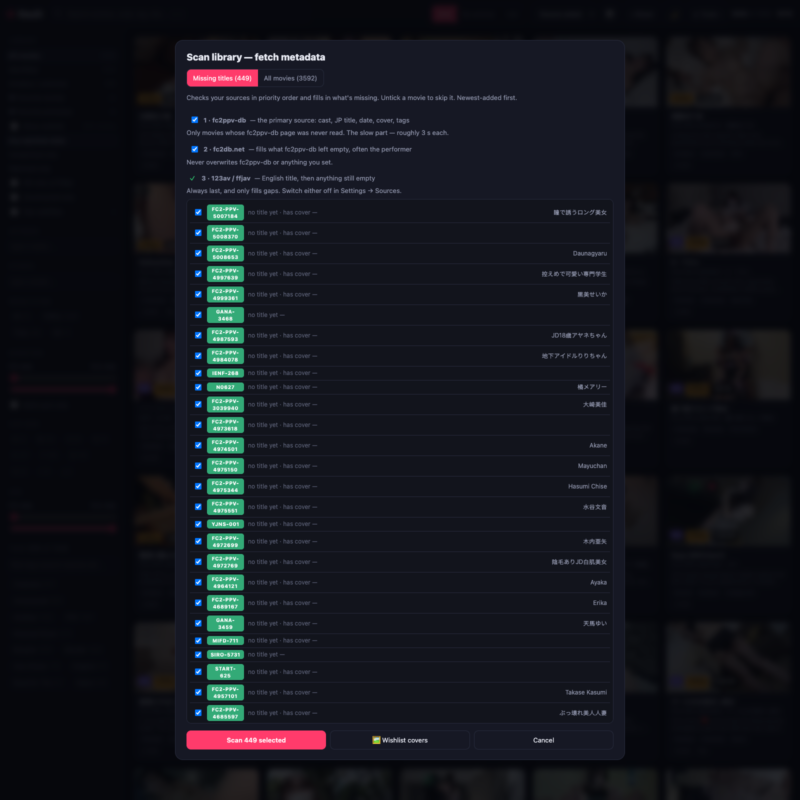

- It re‑indexes the filesystem first (so newly added movies are found), then shows a checklist.
- Toggle **Missing titles** vs **All movies**; untick any code to skip it.
- **Also look up fc2ppv‑db for the actress** is on by default and tells you how many of the
  selected movies it would visit. That pass is the slow part — roughly 3 s each — so the count
  is the honest cost estimate. Untick it for a quick titles‑only pass. If fc2ppv‑db is not
  connected the box is disabled and says why; the titles pass runs either way.
- **Scan N selected** runs in the background — progress shows in the Tools menu, labelled
  by pass (`Titles · 12/40`, then `fc2ppv-db · 3/9`). You can “Run in background” and keep
  browsing.

**Scan metadata** in the player does the same two passes for one movie — with two
differences: it *overwrites* the title, cover and date rather than filling blanks, and it
re‑reads fc2ppv‑db even if that page was read before. It is refused while a library scan is
running, so the two can't fight over the resolver.

### What the counts mean

A finished scan reports three numbers, and the distinction matters:

| | |
|---|---|
| **updated** | the page was read and something was written |
| **not in fc2ppv‑db** | the page was read and the site has nothing for that code |
| **could not be read** | a real failure — resolver down, session rejected |

Only the last one means something is broken. A code the site simply doesn't have is remembered
as *asked and answered*, so later scans skip it instead of re‑reading it forever.

The toolbar's **All movies** widens the *titles* pass to every movie; its fc2ppv‑db pass still
skips pages already read. To genuinely re‑read every fc2ppv‑db page, use **Settings → Sources →
Scan all**, which is the fc2ppv‑db pass only and ignores the stamp.

### Who wins when sources disagree

The order above *is* the priority. **fc2ppv‑db** overwrites; **fc2db.net** and **123av/ffjav**
only fill empty fields, so running fc2db.net before ffjav is what lets its official cover and
sale date beat ffjav's search‑page guesses. Tags from all of them are added together. The two
exceptions are yours:

- **Censorship** you set with the 🔓/🔒 toggle is never overwritten by a scan.
- **An actress you assigned by hand** (edit, reassign or bulk‑assign) is never overwritten. One
  that came from a folder name or from an earlier scan *is* — that is the point of a primary
  source.

A field that an earlier scan already filled stays as it is — Vault doesn't record which source
wrote each field, so it cannot tell an ffjav cover it may replace from one you'd want kept.

## 9. Enrich an actress (verified)

Open a movie by an identified actress → **✎** → **🌐 Enrich from web**. Vault scrapes javdatabase (body info, JP name) and jav.guru (her FC2 filmography).

The key idea is **verification**: it checks whether any code in her online filmography is one **you own**. If yes, it’s her — the profile is applied and her **wishlist** is filled from her filmography. If not, it warns that this might be a different person with the same name and asks before applying. Physical fields are fill‑if‑empty; English + Japanese names are stored as aliases.

## 10. Settings

Open **Settings** from the **☰ Tools** menu. The tabs: Library, Tags, Actresses, Sources, Scene model, Subtitles, Nightly, HTTPS and Updates.

### Scene model

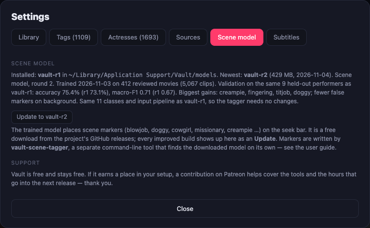

- Shows the installed model and the newest build on GitHub, with one button to **Download** or
  **Update** (about 450 MB). The model knows 10 labels — the acts *blowjob, fingering, titjob,
  toy, creampie* and the positions *missionary, doggy, cowgirl, standing, scoop‑up*. **Toy,
  standing and creampie** were taught to it on Vault's own reviewed markers; the open action model
  it started from could not see them. Each new round is trained on more reviewed movies. The model lands in a per‑user folder
  (`~/Library/Application Support/Vault/models` on macOS, `%LOCALAPPDATA%\Vault\models` on
  Windows, `~/.local/share/vault/models` on Linux).
- **Placing markers:** **Set up** once — it installs what the model needs to run (PyTorch, about
  1 GB) into the same private environment the subtitles use. Then **Place markers on N movies
  without them** works through the library in the background (progress, **Stop**); one movie at a
  time is the **🎬 Place markers** button in its panel, and the nightly run can do new movies on its
  own. A few minutes per movie on an Apple Silicon Mac or with an NVIDIA graphics card; anywhere
  else it runs on the processor and takes hours, and the tab says so.
- **Support:** Vault is free. The tab links to the project's Patreon for anyone who wants to help
  cover the tools and the work behind the next release — voluntary, nothing is held back.

### Library & cache

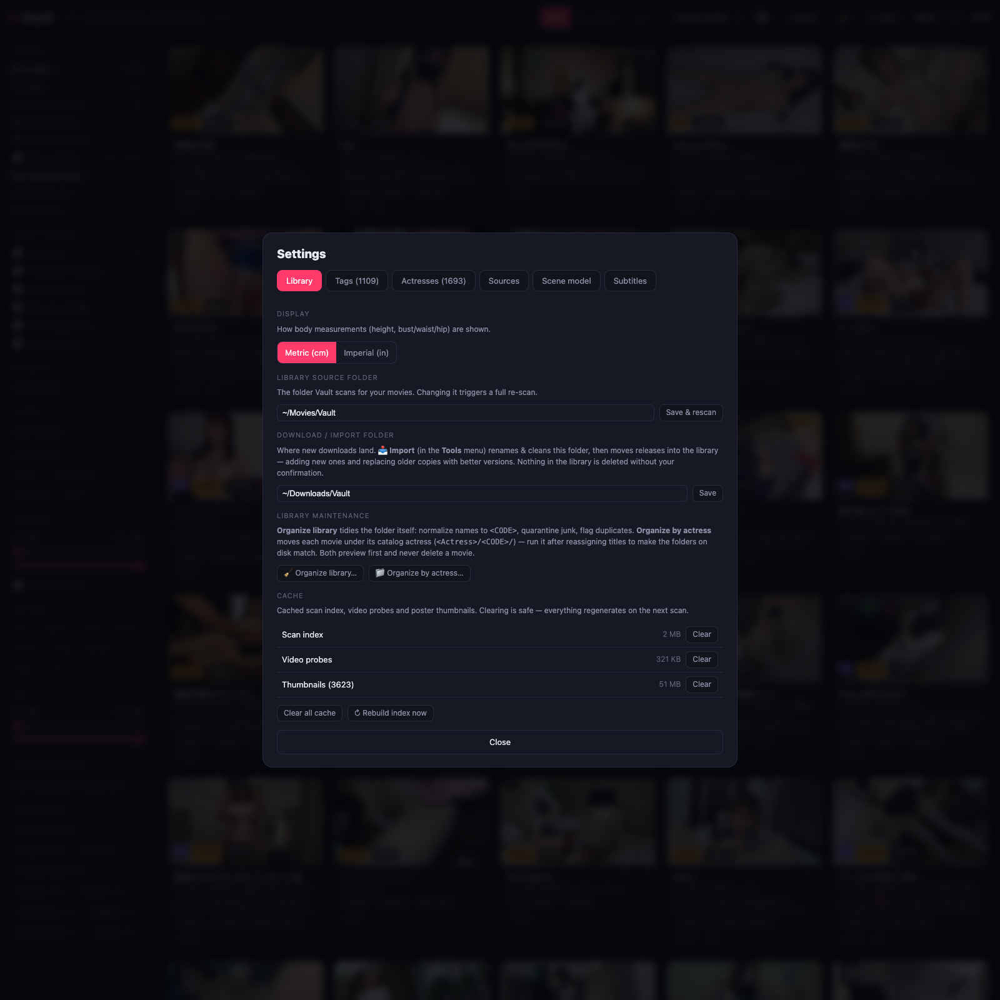

- **Display:** switch measurements between **Metric (cm)** and **Imperial (in)**.
- **Library source folder:** change where Vault scans (triggers a full re‑scan).
- **Download / import folder:** where **📥 Import** (Tools menu) picks up new downloads.
- **Library maintenance:** **🧹 Organize library…** normalizes names / quarantines junk / flags duplicates; **📁 Organize by actress…** folds movies into `…/<Actress>/<CODE>/` to match the catalog (see [§7](#7-import-from-your-download-folder)). Both preview first and never delete a movie.
- **Cache:** see and clear the scan index, video probes, thumbnails and scrub previews (all safe to clear — they regenerate; *Clear all cache* leaves the scrub previews alone, as they take longest to make again). **Rebuild index now** re‑reads the catalog.

### Tags & translations

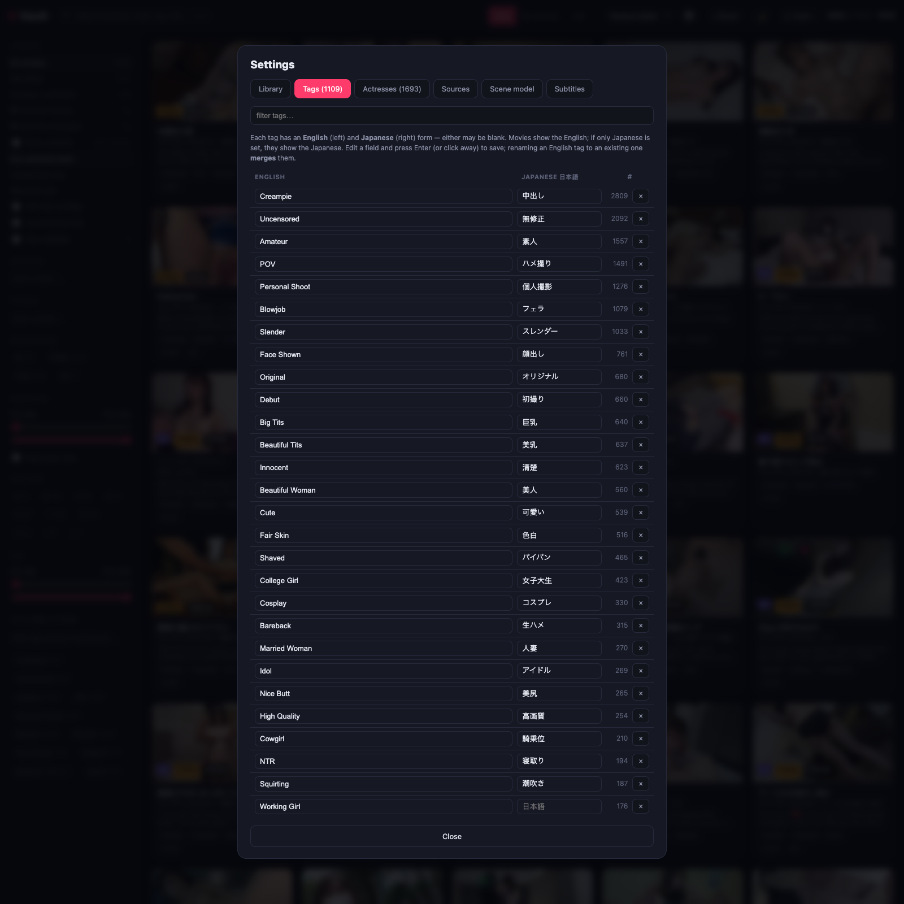

**Standardize tags** (top of the tab, **off** by default). The sources tag the same thing many
ways — *Raw* and *Bareback*, *Cuckold* and *NTR*, *3P* written three ways — add shop wording
(*Sold Out*, *With Bonus*), repeat what Vault already shows as a field (*Uncensored*, cup sizes,
ages) and leave Japanese one-offs that nobody translated. Switched **on**, Vault folds them into
one set of about 190 tags:

- the tags already in your catalog are rewritten at once, and the tab says how many tags and
  movies that touches (*The rules for this catalog* lists every merge and removal);
- every tag a later scan, the nightly run or an update's catalog brings in is standardized the
  same way; tags you type on a movie yourself stay as you typed them;
- your own renames and merges below still apply first;
- **Off** puts the original tags back (tags stored while it was on stay standardized).

Tags that imply a minor are removed either way.

- **In use:** every tag in your library with its count. **Rename** a tag (renaming to an existing one **merges** them — e.g. fix a typo), or remove it.
- **Translations:** a JP→EN dictionary (seeded with common FC2 tags). Set the **English label** a raw/Japanese tag displays under — e.g. `中出し → Creampie`. Japanese tags coming from the scrapers show under these labels automatically.

> **Merges and cleanups stick — for every future scan, and for everyone.** When you merge two tags, Vault records the mapping (old → new) in the translation table, so the next time a scraper sees the old name it stores the merged one instead. The scrapers canonicalize every incoming tag through this table: a Japanese tag becomes its English label, a merged name becomes its target, and an **untranslated Japanese tag is dropped** rather than added — which keeps one‑off junk out of your set without any manual pruning. English tags that have no mapping are kept as‑is. Because the mapping lives in the catalog, a shared build carries your cleanups to other users too.

### Actresses & de-duplication

- Rename any actress (English + Japanese); the old spelling is kept as an alias.
- Tick two or more rows and **Merge** them (the record you own most titles under is kept; works, aliases, links, and body‑info fold in — no movie is ever deleted).
- **Find duplicates** scans the whole catalog for same‑person records (identical Japanese name or reversed romaji) and offers to merge them all.

### Sources & fc2ppv-db

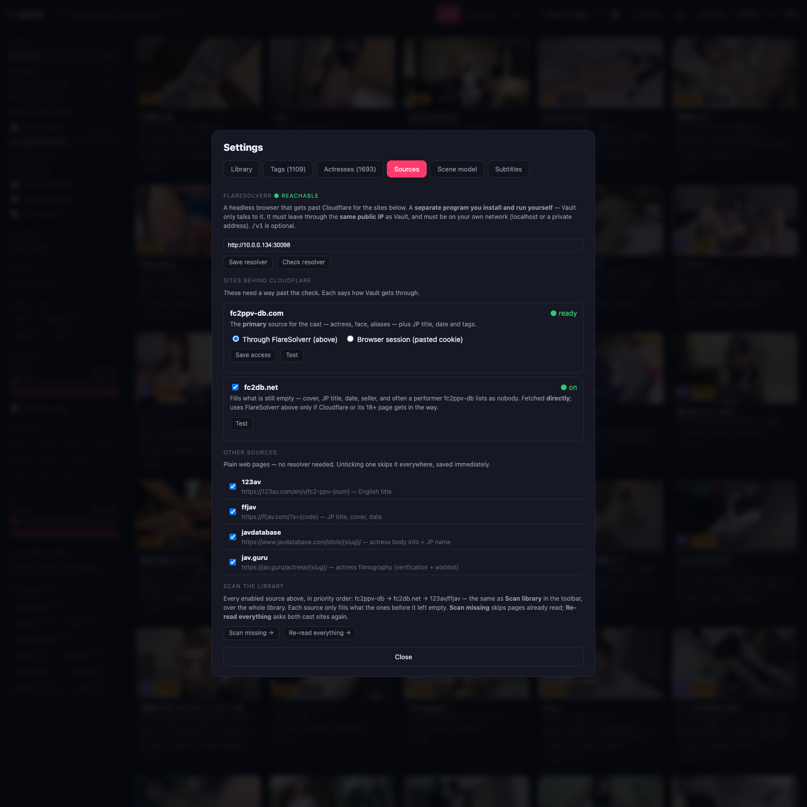

The pane is in the order you set things up.

**1. FlareSolverr** — the resolver itself, with no site attached. Paste its URL, **Save
resolver**, then **Check resolver**, which asks it directly and reports its version. It is a
separate program you install and run yourself (see the README's *Optional: FlareSolverr*); it
must leave through the same public IP as Vault and sit on your own network.

**2. Sites behind Cloudflare** — one card each, saying how Vault gets through:

- **fc2ppv‑db.com** — the primary source for the cast. Choose **Through FlareSolverr** or
  **Browser session** (paste the `cookie:` and `user-agent:` headers from a browser on this
  machine; stored in the Keychain). **Save access**, then **Test**.
- **fc2db.net** — fills what is still empty, often including a performer fc2ppv‑db lists as
  nobody. It is fetched directly and only uses the resolver if Cloudflare or its 18+ page gets in
  the way. Tick or untick it here; **Test** fetches one real page.

**3. Other sources** — 123av, ffjav, javdatabase and jav.guru: plain pages, no resolver. Every
checkbox is a real switch and saves the moment you click it.

**4. Scan the library** — runs **every enabled source** over the whole library, in order:
titles → fc2ppv‑db → fc2db.net. **Scan missing** skips pages each site has already answered;
**Re‑read everything** asks both cast sites again. This is the same pipeline as the toolbar's
**Scan library** and the player's **Scan metadata** — no scan button checks fewer sources than
another.

### Subtitles

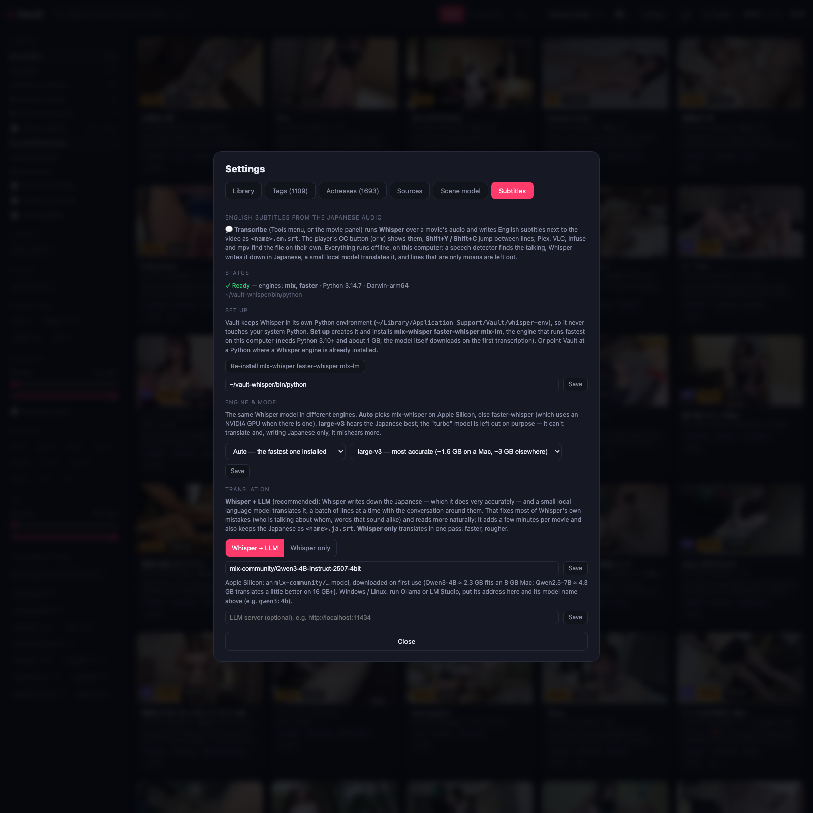

- **Status** shows which Whisper engines the subtitle environment can run and whether the
  translator is installed. **Set up** creates that environment for you (its own Python
  environment, about 1 GB); the models download the first time you
  transcribe (Whisper ~1.6 GB, the translator ~2.3 GB on a Mac). Or point **Python** at one you
  installed yourself.
- **Engine:** *auto* picks the fastest installed (mlx on an Apple Silicon Mac, faster‑whisper
  elsewhere). **Model:** large‑v3 (best), medium or small.
- **Translation:** *Whisper + LLM* (default — Whisper writes the Japanese, a small local model
  translates it with the conversation as context) or *Whisper only* (faster, rougher). On Windows /
  Linux, run Ollama or LM Studio and enter its **server address** and **model** here.

### HTTPS

**Turn on HTTPS** makes a certificate for this computer and switches HTTPS on right away; other
devices then open `https://<this-machine>:8730/`. Each phone or computer trusts the certificate
once — the tab lists the steps for iPhone, Android, Mac and Windows, starting with
`http://<this-machine>:8730/vault-ca.crt`. **Renew** after the computer got a new network address
(the tab warns when it did); devices keep trusting it. **Turn off** goes back to plain HTTP. On the
computer itself `http://127.0.0.1:8730/` always works.

### Updates

Shows this version and the newest one on GitHub, with its release notes. **Update** downloads the
installer for this computer, checks it against GitHub's checksum and installs it: on Windows the
setup runs silently and Vault starts again; on a Mac Vault replaces the app (it has to be in the
Applications folder) and reopens. The page reloads by itself when the new version answers. Your
library, settings and data stay as they are, and a newer catalog in the update is merged into
yours without touching what you set, own or deleted. **Reinstall** puts the current version back
— a repair. The daily check (on by default) only asks GitHub which version is newest; switch it
off and Vault looks only when you press **Check now**. A **⬆ Update available** entry appears in
the ☰ Tools menu when there is one. Running from source: `git pull`.

### Nightly

Switch the nightly run on, set the hours it may work in, and tick what it should do: import,
metadata, scene markers, subtitles, scrub previews. **Run now** does the same at once, for at most the window's
length; **Stop** ends it. *Status* shows the next run and what the last one did. Details in
[The nightly run](#13-the-nightly-run).

---

## 11. Using Vault on your phone

Vault is one responsive page — there is no separate mobile site and nothing to install. Open the machine's LAN address from any device on the same network, or over a VPN back to it:

```
http://<this-machine-ip>:8730/
```

On macOS `ipconfig getifaddr en0` prints the address; on Linux use `hostname -I`. `127.0.0.1` only works on the machine itself.

> Vault has **no login**. With **Settings → HTTPS** turned on, nobody on the network can read along — but anyone who can reach that address still gets your whole library, and `Open in external player` / `Reveal in Finder` act on the host machine. Keep it to networks you trust, and don't port‑forward it.

**What changes on a narrow screen**

| | Desktop | Phone |
|---|---|---|
| Poster wall | 5–7 columns | 2 columns |
| Filters | sidebar, always visible | **☰ Filters** slide‑over drawer; picking one closes it so you see the results |
| Card buttons (♥ / ✓) | appear on hover | always visible — there is no hover on touch |
| Player | video between two side rails | video on top, **Info** / **Parts · Related** tabs beneath |
| Long titles on cards | shown | hidden below 430 px, where they'd swamp the card |

It's driven by window width, not by device detection, so a narrow window on a desktop gets the same treatment — and an iPad reporting itself as a Mac still gets the right layout.

**Adding it to your home screen (iOS):** Share → *Add to Home Screen*. It opens full‑screen like an app.

**Performance.** The grid renders in batches of 120 as you scroll rather than building every card up front — that is what keeps a multi‑thousand‑item library inside mobile Safari's per‑tab memory limit. Scrolling all the way through a very large unfiltered library still accumulates cards; filtering or searching first is both faster and lighter.

## 12. Subtitles (Japanese → English)

Vault can write English subtitles for a movie from its Japanese audio — offline, on your own
computer. Nothing is uploaded anywhere.

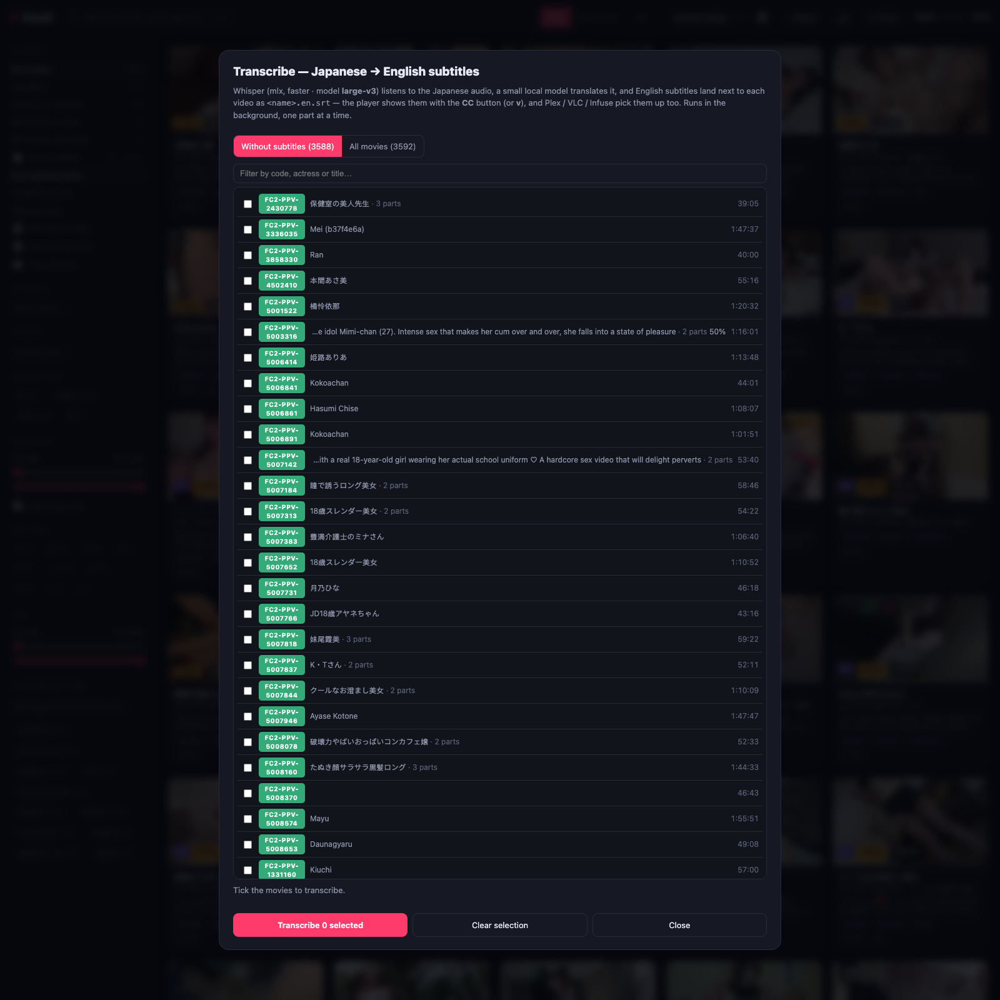

- **☰ Tools → 💬 Transcribe** lists your movies (*without subtitles* or *all*, with a filter); tick
  the ones you want and start. Or open a movie and press **💬 Transcribe (JA → EN)** in its panel.
- It runs in the background, one part at a time; the Tools menu shows the progress and can stop it.
  Expect roughly 15–30 minutes per hour of video on an 8 GB M1 Mac — less on a faster Mac or with an
  NVIDIA GPU.
- Each part gets `<video>.en.srt` (and the Japanese `<video>.ja.srt`) next to the file. Plex, VLC,
  Infuse and mpv pick them up on their own.
- In the player: **CC** (or `v`) turns them on/off, `y` / `c` jump between lines.
  The sidebar's **Has subtitles** filter finds the movies that have them.

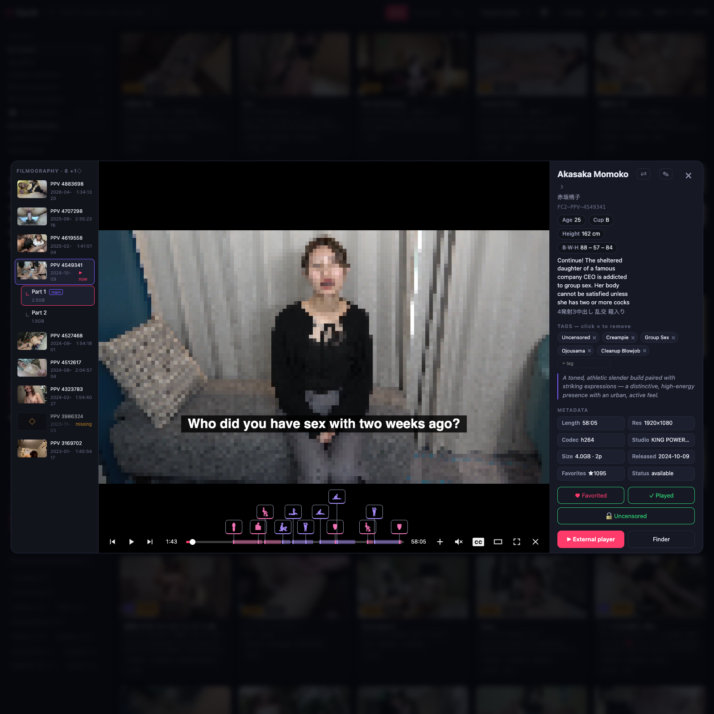

**What to expect.** The Japanese transcript is usually accurate; the English is good for following
the conversation, with roughly one line in five off — mostly where the speech was misheard, or who
is talking to whom got mixed up. Vault tells the man's voice from the woman's by its pitch and
tells the translator who says each line, which fixes part of that. Each release improves the
translator's glossary. Lines that are only moans, sighs or
laughter are left out; short answers and questions (はい, いや, え?) stay. Words said while moaning
are caught by a second, careful listen to the quiet stretches.

**First time:** Settings → Subtitles → **Set up** (see [Settings](#subtitles)). The installers bring
everything else; from source it needs Python 3.10 or newer and `ffmpeg` on the computer.

## 13. The nightly run

**Settings → Nightly** lets Vault look after the library by itself, once a night, while you sleep.

- **When.** Pick the hours it may work in, e.g. *01:00 – 06:00* (a window can cross midnight).
  The run starts when the window opens and every step stops when it closes; whatever is left is
  picked up the next night. The computer has to be on — Vault keeps a Mac awake while the run
  lasts, but it can't wake a sleeping one.
- **📥 Import** — the download folder into the library, as with **Import** in the Tools menu. The
  two choices the Import window asks are made here: a **bigger version** of a movie you already
  have either *replaces the library copy* or is *left for you to decide*; a **duplicate** (the
  library copy is as good or bigger) is either *deleted* or *left in the download folder*. Anything
  left behind is in the Import window the next time you open it. Point the download folder at
  finished downloads only.
- **🔎 Metadata for new movies** — only movies added since you switched the nightly run on. When
  the sources have nothing for a movie, it is asked again after a week at the earliest, so the
  sites don't see the same misses every night (at most 200 movies a night). The rest of the
  library stays with **Scan library**.
- **🎬 Scene markers** — places markers with the scene model, like Settings → Scene model → Place
  markers, for the *new movies* or *working through the whole library*. Movies that already have
  markers are skipped. Needs the model and **Set up** in Settings → Scene model (the box takes
  another tagger command, if you have one).
- **💬 Subtitles** — the same as 💬 Transcribe, for the *new movies* or *the whole library, newest
  first*. When scene markers also work through the whole library, they get at most half of the
  night, so the subtitles get their turn.
- **🎞 Scrub previews** — the frames for the player's seek bar, for the *new movies* or *the whole
  library, favourites first, then newest*. About a minute per hour of video; it waits while
  you're watching something, and a movie the window ends on keeps its frames and is finished the
  next night. When subtitles also work through the whole library, they leave a third of the night
  for this.

The steps run in that order, one after the other — never two heavy jobs at once.
